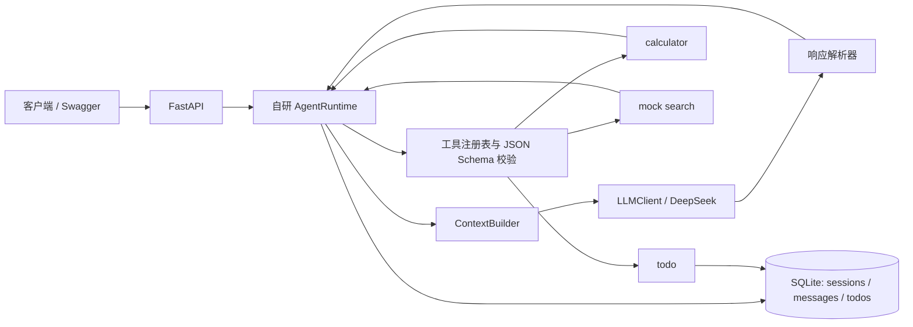

# 自研 Agent Runtime

这是一个基于 Python、FastAPI 和 SQLite 实现的轻量 Agent Runtime 示例。Agent 的决策循环、响应解析、工具注册与参数校验、session 管理和上下文压缩均由项目实现，不依赖 LangGraph、OpenHands、OpenClaw 或其他 Agent Runtime 框架。

模型通过 OpenAI Chat Completions 兼容适配器接入 DeepSeek。已使用真实 DeepSeek API 验证模型直接回复和工具调用：模型通过 `calculator` 计算 `12 * (3 + 1)`，Runtime 执行工具并把 `48` 返回给模型后生成最终答复。

## 环境要求

- Python 3.11 或更新版本
- DeepSeek API Key（只在需要真实模型运行时使用）

## 安装与启动

在 Windows PowerShell 中，从项目根目录运行：

```powershell
python -m venv .venv
.\.venv\Scripts\python.exe -m pip install -e ".[dev]"

$env:OPENAI_API_KEY = [Environment]::GetEnvironmentVariable('OPENAI_API_KEY', 'User')
$env:OPENAI_MODEL = [Environment]::GetEnvironmentVariable('OPENAI_MODEL', 'User')
$env:OPENAI_BASE_URL = [Environment]::GetEnvironmentVariable('OPENAI_BASE_URL', 'User')
$env:AGENT_DB_PATH = 'agent.sqlite3'

if ([string]::IsNullOrWhiteSpace($env:OPENAI_API_KEY)) {
    throw 'OPENAI_API_KEY is not configured for this Windows user.'
}

.\.venv\Scripts\python.exe -m uvicorn app.api:app --host 127.0.0.1 --port 8001 --reload
```

这会从 Windows 当前用户环境变量读取 API Key、模型名和兼容接口地址，不会把密钥写入仓库。当前本机实例地址为 <http://127.0.0.1:8001>，Swagger 页面为 <http://127.0.0.1:8001/docs>。若端口已被占用，可改用其他空闲端口，并同步更新请求地址。

配置项如下：

| 环境变量 | 当前值/默认值 | 用途 |
| --- | --- | --- |
| `OPENAI_API_KEY` | 本机用户环境变量 | DeepSeek API 密钥；不得提交到仓库。 |
| `OPENAI_MODEL` | `deepseek-chat` | 使用的模型。 |
| `OPENAI_BASE_URL` | `https://api.deepseek.com/v1` | OpenAI Chat Completions 兼容 API 地址。 |
| `AGENT_DB_PATH` | `agent.sqlite3` | SQLite 数据库文件路径。 |
| `AGENT_DEV_USER_ID` | `local-user` | 本地开发身份标识。 |

应用从进程环境变量读取配置，不会自动加载 `.env`。`.env` 已加入 `.gitignore`，`.env.example` 只包含占位配置。

## 使用 API

- `GET /healthz`：健康检查。
- `POST /sessions`：创建独立对话 session。
- `GET /sessions`：列出当前开发身份的 session。
- `GET /sessions/{session_id}`：获取 session 信息。
- `GET /sessions/{session_id}/messages`：读取完整消息历史，包括工具调用和结果。
- `POST /sessions/{session_id}/messages`：在指定 session 中继续对话。

先创建 session：

```json
POST /sessions
{"title":"窗口 1"}
```

把响应中的 `id` 用于后续消息：

```json
POST /sessions/{session_id}/messages
{"content":"计算 12 * (3 + 1)"}
```

响应包含 `status`、`assistant_message`、`model_turns` 和 `tool_calls`。同一窗口继续聊天时重复使用同一个 `session_id`；新窗口创建新的 session。PowerShell 完整示例见[使用说明](outputs/Agent_Runtime_使用说明.md)。

## 系统设计



一次消息的处理顺序：

1. API 校验 session 所属身份，Runtime 将用户消息写入对应历史。
2. ContextBuilder 从该 session 读取摘要和消息，组装当前模型请求。
3. LLM 返回最终文本，或返回一个/多个工具调用。
4. Runtime 解析统一响应，校验工具名和参数 Schema，再执行已注册工具。
5. Runtime 持久化工具调用和结果，并将结果回传模型；收到最终答复后保存并返回。

默认最多进行 5 次模型决策，每次最多接受 3 个工具调用。工具错误会作为结果写入历史后交给模型处理；无效响应、LLM 错误和达到轮次上限会受控终止。

### 工具

| 工具 | 功能 | 限制 |
| --- | --- | --- |
| `calculator` | 四则运算、括号和小数。 | 使用 AST 节点白名单计算，不调用 `eval`；不支持变量、函数或任意 Python 代码。 |
| `search` | 搜索示例数据。 | 当前为固定 mock，不访问互联网。 |
| `todo` | 新增、列出、完成待办。 | Todo 存储在 SQLite，并按用户和 session 校验归属。 |

## Memory 的存放与召回

本项目的 memory 是 session 级对话记忆，不包含向量数据库或跨 session 的长期用户记忆。

| 信息 | 存放位置 | 召回时机 |
| --- | --- | --- |
| 用户、助手消息及工具调用/结果 | SQLite `messages` 表 | 每次模型决策前，读取当前 session 的消息历史。工具调用和结果在下一次请求中按原有结构还原。 |
| 较早对话的摘要 | SQLite `sessions.summary` | 每次模型请求时随系统消息加入当前 session 的上下文。 |
| 待办事项及完成状态 | SQLite `todos` 表 | Agent 判断需要查询或修改待办时调用 `todo` 工具；不会把所有 Todo 常驻塞入提示词。 |
| 系统规则与工具 Schema | Runtime 配置和工具注册表 | 每次请求将系统规则、可用工具定义一并发送给模型。 |

ContextBuilder 在每次模型决策前运行。用户当前消息会先写入历史，所以只从历史读取一次，不会再次重复拼接。消息历史超过 20 条时，Runtime 请求模型摘要较早的消息，把最多 4,000 字符的摘要保存在 `sessions.summary`，并在模型请求中保留最近 10 条原始消息。切分时会尽量保留 assistant 工具调用与对应 tool 结果的完整关系。摘要不会删除原始历史；摘要生成失败时保留旧摘要和完整消息上下文。

两个窗口必须使用不同 `session_id`。每次构建上下文、读取摘要、执行 Todo 查询都限定在当前 session，因此窗口之间的消息、摘要和待办不会相互混用。SQLite 在服务重启后继续保留这些数据。

## 验证

离线测试用 fake LLM 和临时 SQLite 数据库，不访问模型服务、不需要 API Key：

```powershell
.\.venv\Scripts\python.exe -m pytest -q
```

本项目已另行执行真实 DeepSeek API 验证：一轮真实模型工具调用使用 `calculator`，工具结果为 `48`，最终状态为 `completed`。这项在线验证会消耗少量 API 额度；离线测试不会。

## 本地安全边界

当前默认身份是固定的 `local-user`，接口没有登录认证，服务默认绑定 `127.0.0.1`，仅适用于本地开发。正式部署前必须接入可信认证，校验所有 session 访问，并配置服务端网络隔离和密钥管理；不要将本地开发服务直接暴露到公网。

## 更多文档

- [本地使用说明](outputs/Agent_Runtime_使用说明.md)
- [开发实施指南](outputs/Agent_Runtime_开发实施指南.md)
- [AI Prompt 与问题解决记录](outputs/AI_Prompt_与问题解决记录.md)
